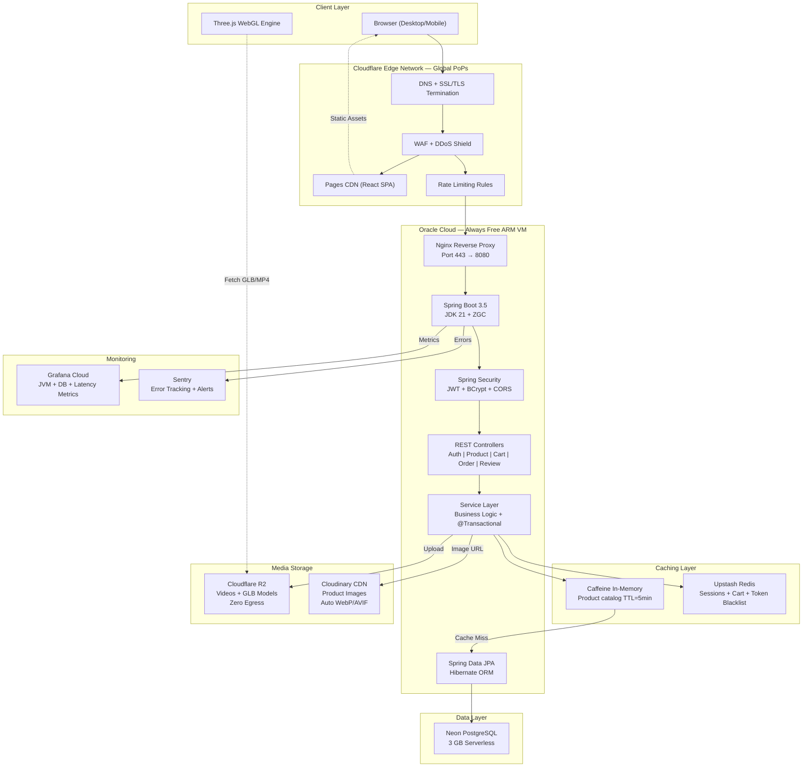
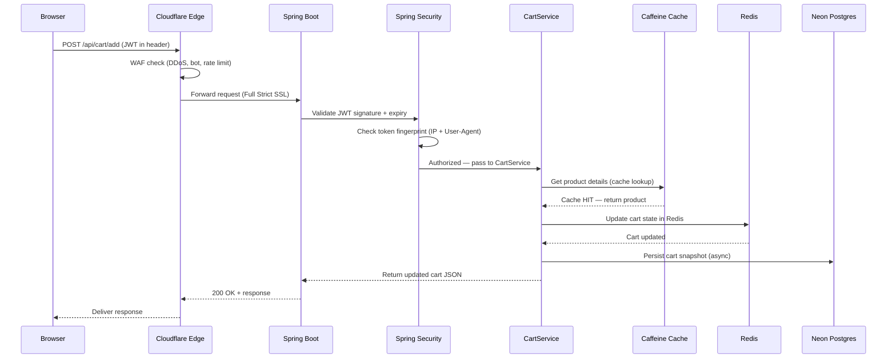
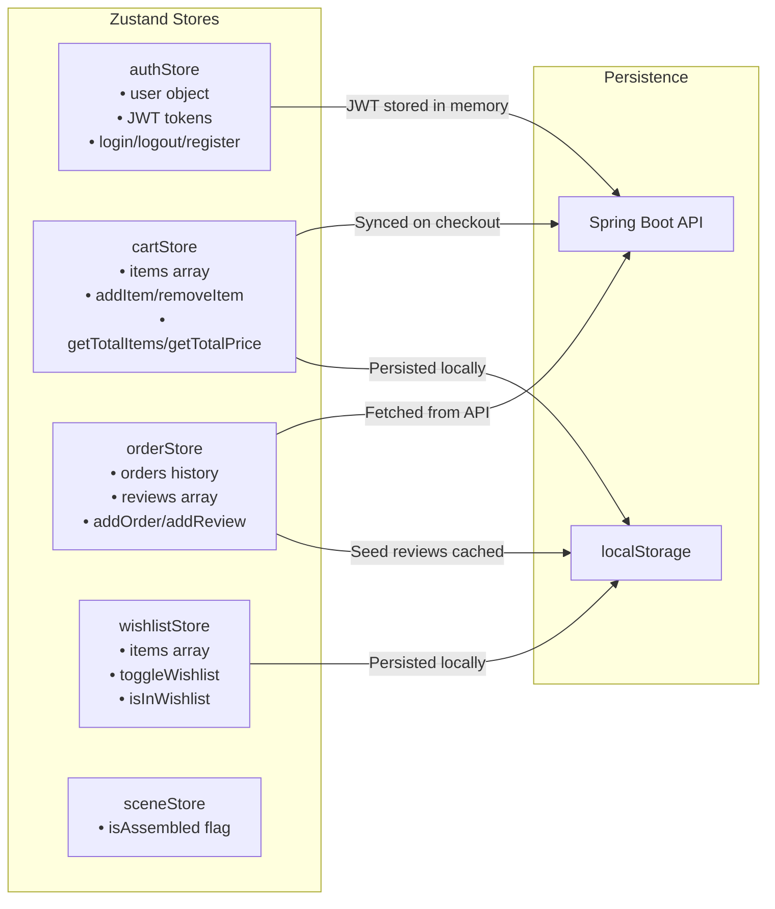
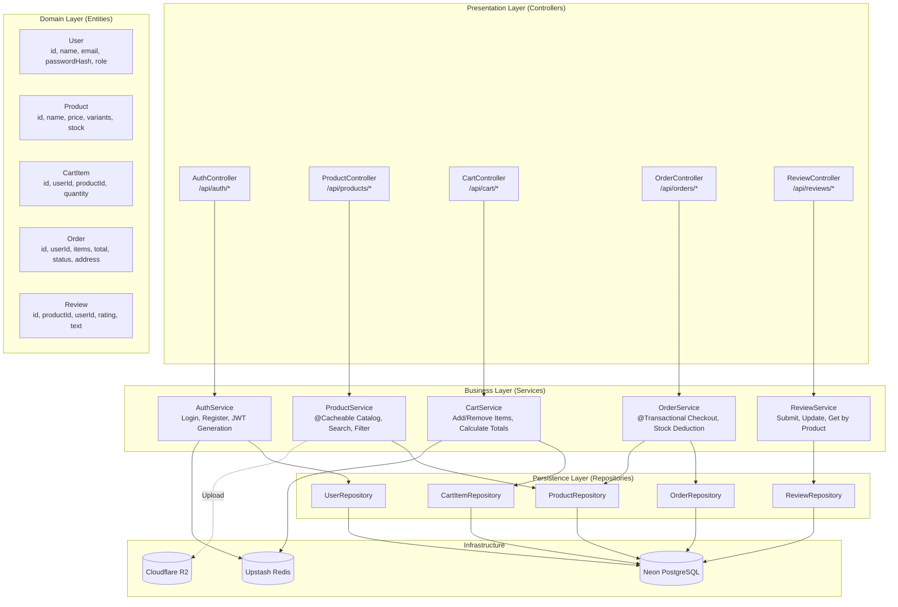
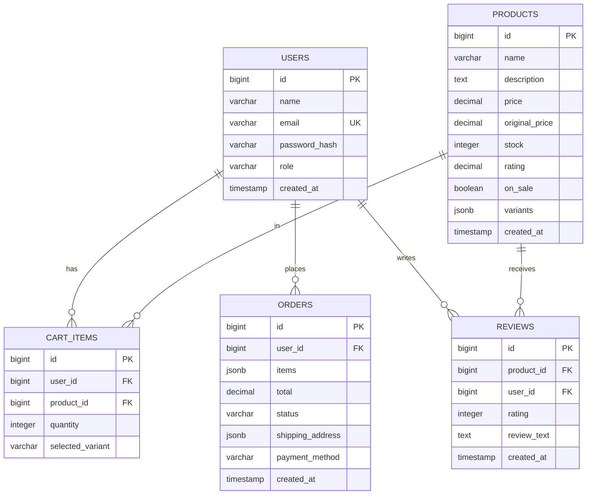
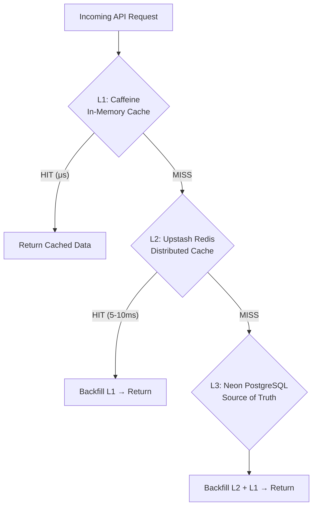
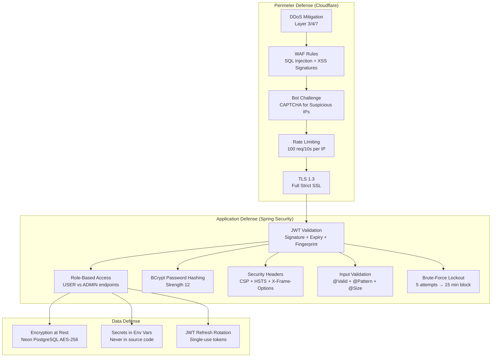
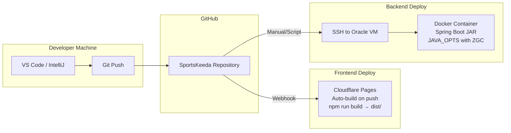
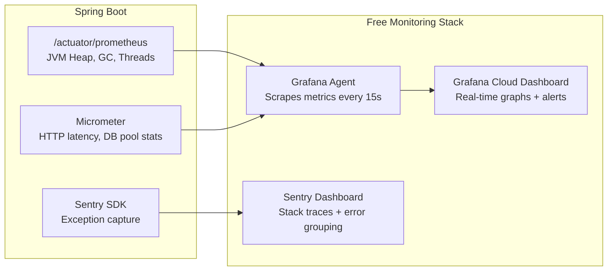

# Yatra X — Complete System Architecture & Design

> **Document Type:** Technical Architecture Reference  
> **Last Updated:** 2026-05-30  
> **Stack:** React 18 + Three.js (Frontend) | Spring Boot 3.5 + JDK 21 (Backend) | PostgreSQL + Redis (Data) | Cloudflare (Edge)

---

## 1. High-Level System Architecture



---

## 2. Request Lifecycle (End-to-End Flow)

What happens when a user clicks "Add to Cart" on a product:



---

## 3. Frontend Architecture

### 3A. Technology Stack & Rationale

| Technology | Purpose | Why This Choice |
|---|---|---|
| **React 18** | UI component library | Virtual DOM for performant re-renders; massive ecosystem |
| **Vite** | Build tool + dev server | 10x faster HMR than Webpack; native ESM support |
| **Three.js + R3F** | 3D WebGL rendering | Industry standard for browser 3D; React bindings via @react-three/fiber |
| **@react-three/drei** | 3D helpers | OrbitControls, Environment maps, GLTF loaders out-of-the-box |
| **GSAP** | Timeline animations | Assembly animation, scroll effects; GPU-accelerated tweens |
| **Framer Motion** | Component transitions | Page entry/exit animations; gesture support |
| **React Router v6** | Client-side routing | SPA navigation without full page reloads |
| **Zustand** | Global state management | Lightweight (1KB); no boilerplate vs Redux; built-in persistence |
| **Vanilla CSS** | Styling | Full control; CSS custom properties for design tokens; no framework lock-in |
| **Lucide React** | Icons | Tree-shakeable; consistent design language |
| **Axios** | HTTP client | Interceptors for JWT injection; request/response transformations |

### 3B. Component Architecture

```
src/
├── main.jsx                    # App entry — mounts React to DOM
├── App.jsx                     # Router + Layout shell
├── index.css                   # Global design tokens + CSS reset
│
├── components/
│   ├── layout/
│   │   ├── Header.jsx          # Glassmorphic navbar (logo, search, auth, cart)
│   │   └── Footer.jsx          # Brand info, links, newsletter, social icons
│   │
│   ├── three/
│   │   ├── Scene.jsx           # Canvas wrapper (WebGLRenderer config, lighting)
│   │   └── Parallettes.jsx     # 3D model (procedural geometry + GSAP assembly)
│   │
│   └── ui/
│       ├── FeatureCards.jsx     # Glassmorphic cards floating around 3D model
│       ├── ProductCard.jsx      # Shop grid card (image, price, variants, cart CTA)
│       ├── ProductCarousel.jsx  # Horizontal scroll carousel
│       └── Loader.jsx           # Brand splash screen animation
│
├── pages/
│   ├── Home.jsx                # Hero + 3D + Welcome + Carousels + Reviews + Discount
│   ├── Shop.jsx                # Product catalog with search/filter
│   ├── ProductDetail.jsx       # Single product + 3D viewer + reviews
│   ├── Cart.jsx                # Cart items + quantity controls + totals
│   ├── Checkout.jsx            # Address + payment + order placement
│   ├── Login.jsx               # Authentication form
│   ├── Register.jsx            # User registration with validation
│   └── OrderHistory.jsx        # Past orders + review submission
│
├── store/
│   ├── authStore.js            # JWT tokens, user profile, login/logout
│   ├── cartStore.js            # Cart items, quantities, totals
│   ├── orderStore.js           # Order history + reviews (with localStorage seed)
│   ├── wishlistStore.js        # Wishlist with localStorage persistence
│   └── sceneStore.js           # 3D scene state (assembly complete flag)
│
├── services/                   # API layer (Axios calls to Spring Boot)
│   └── api.js                  # Base Axios instance + JWT interceptor
│
└── utils/
    └── constants.js            # Product data, helper functions
```

### 3C. State Management Architecture (Zustand)



---

## 4. Backend Architecture

### 4A. Technology Stack & Rationale

| Technology | Purpose | Why This Choice |
|---|---|---|
| **Spring Boot 3.5** | Application framework | Auto-configuration, embedded Tomcat, production-ready defaults |
| **JDK 21 (LTS)** | Runtime | Latest LTS; virtual threads, ZGC, pattern matching |
| **Spring Security** | Authentication & authorization | JWT filter chain, BCrypt, method-level `@PreAuthorize` |
| **Spring Data JPA** | Database ORM | Repository pattern; Hibernate under the hood; zero SQL boilerplate |
| **PostgreSQL** (Neon) | Relational database | ACID compliance, JSON support, free serverless hosting |
| **HikariCP** | Connection pool | Fastest Java connection pool; Spring Boot default |
| **Lombok** | Boilerplate reduction | Auto-generates getters/setters/constructors at compile time |
| **Caffeine** | In-memory cache | Zero-dependency; microsecond lookups for hot product data |
| **Spring Data Redis** | Distributed cache | Session tokens, cart state, JWT blacklist via Upstash |
| **Spring Boot Actuator** | Health & metrics | `/actuator/health`, Prometheus endpoint for Grafana |
| **Sentry SDK** | Error tracking | Auto-catches exceptions; sends stack traces to dashboard |

### 4B. Layered Architecture (SOLID Compliant)



### 4C. Package Structure

```
backend/src/main/java/com/yatrax/
├── YatraXApplication.java              # @SpringBootApplication entry point
│
├── config/
│   ├── SecurityConfig.java             # JWT filter chain, CORS, CSP, security headers
│   ├── CorsConfig.java                 # Allowed origins (Vercel + localhost)
│   ├── CacheConfig.java                # Caffeine cache configuration
│   └── RedisConfig.java                # Upstash Redis connection
│
├── security/
│   ├── JwtTokenProvider.java           # Generate/validate JWT tokens
│   ├── JwtAuthFilter.java              # OncePerRequestFilter — extracts JWT from header
│   └── TokenFingerprint.java           # IP + User-Agent binding for session hijack prevention
│
├── controller/
│   ├── AuthController.java             # POST /api/auth/login, /register, /refresh
│   ├── ProductController.java          # GET /api/products, /api/products/{id}
│   ├── CartController.java             # POST/PUT/DELETE /api/cart
│   ├── OrderController.java            # POST /api/orders, GET /api/orders/history
│   └── ReviewController.java           # POST /api/reviews, GET /api/reviews/product/{id}
│
├── service/
│   ├── AuthService.java                # BCrypt hashing, JWT generation, brute-force lockout
│   ├── ProductService.java             # @Cacheable catalog, search, variant resolution
│   ├── CartService.java                # Redis-backed cart state management
│   ├── OrderService.java               # @Transactional checkout, ACID stock deduction
│   ├── ReviewService.java              # Review CRUD with ownership validation
│   └── StorageService.java             # R2/S3 SDK file upload streaming
│
├── model/
│   ├── User.java                       # @Entity — id, name, email, passwordHash, role, createdAt
│   ├── Product.java                    # @Entity — id, name, description, price, stock, variants
│   ├── CartItem.java                   # @Entity — id, userId, productId, quantity, variant
│   ├── Order.java                      # @Entity — id, userId, items, total, status, address, createdAt
│   └── Review.java                     # @Entity — id, productId, userId, rating, text, createdAt
│
├── repository/
│   ├── UserRepository.java             # findByEmail, existsByEmail
│   ├── ProductRepository.java          # findByNameContaining, findByPriceBetween
│   ├── CartItemRepository.java         # findByUserId, deleteByUserIdAndProductId
│   ├── OrderRepository.java            # findByUserIdOrderByCreatedAtDesc
│   └── ReviewRepository.java           # findByProductId, findByProductIdAndUserId
│
├── dto/
│   ├── LoginRequest.java               # email, password
│   ├── RegisterRequest.java            # name, email, password (with @Valid constraints)
│   ├── CartRequest.java                # productId, quantity, variant
│   ├── OrderRequest.java               # address, paymentMethod, items
│   ├── ReviewRequest.java              # productId, rating, text (with XSS regex validation)
│   └── AuthResponse.java              # accessToken, refreshToken, user profile
│
└── exception/
    ├── GlobalExceptionHandler.java     # @ControllerAdvice — catches all exceptions
    ├── ResourceNotFoundException.java  # 404 responses
    └── AccountLockedException.java     # 429 for brute-force lockout
```

---

## 5. Database Architecture

### 5A. Entity-Relationship Diagram



### 5B. Data Storage Strategy

| Data Type | Where It Lives | Why |
|---|---|---|
| User credentials (email, hashed password) | **Neon PostgreSQL** | ACID transactions; relational integrity; encrypted at rest |
| Product catalog (name, price, variants) | **Neon PostgreSQL** + **Caffeine cache** | Source of truth in DB; hot data cached in-memory for 5 min |
| Shopping cart state | **Upstash Redis** + **Neon PostgreSQL** | Redis for real-time speed; DB for persistence across sessions |
| Order records | **Neon PostgreSQL** | Transactional; must survive server restarts; audit trail |
| Product reviews | **Neon PostgreSQL** | Relational (linked to user + product); queryable ratings |
| Product images (JPEG/PNG) | **Cloudinary** | Auto WebP/AVIF conversion; responsive resize on delivery |
| Product videos (MP4) | **Cloudflare R2** | Zero egress fees; pre-transcoded to 480p/720p/1080p |
| 3D models (GLB) | **Cloudflare R2** | Large binary files; immutable cache headers; content-hash filenames |
| JWT blacklist (revoked tokens) | **Upstash Redis** | TTL-based auto-expiry; no DB bloat from expired tokens |
| Session fingerprints | **In JWT claims** | Stateless; validated on every request without DB lookup |

---

## 6. Caching Architecture



| Cache Layer | Technology | TTL | What's Cached | Avg Latency |
|---|---|---|---|---|
| **L1** (Hot) | Caffeine (JVM heap) | 5 minutes | Product catalog, 3D model metadata | **<1 ms** |
| **L2** (Warm) | Upstash Redis | 30 minutes | Cart state, session tokens, JWT blacklist | **5–10 ms** |
| **L3** (Cold) | Neon PostgreSQL | Permanent | All transactional data (source of truth) | **30–80 ms** |

**Cache Invalidation Strategy:**
- **Write-through:** When a product is updated, `@CacheEvict` clears Caffeine + Redis entries.
- **TTL-based:** Stale data auto-expires; acceptable for catalog (5 min stale is fine).
- **Event-driven:** Order placement evicts cart cache for that user immediately.

---

## 7. Security Architecture



---

## 8. Deployment Architecture



### Deployment Commands

**Frontend (Automatic):**
Cloudflare Pages auto-deploys on every `git push` to `main`. No manual steps.

**Backend (On Oracle VM):**
```bash
# Build the JAR
cd backend && ./mvnw clean package -DskipTests

# Run with production settings
java $JAVA_OPTS -jar target/backend-0.0.1-SNAPSHOT.jar \
  --spring.profiles.active=production
```

**Docker Alternative:**
```dockerfile
FROM eclipse-temurin:21-jre-alpine
COPY target/backend-0.0.1-SNAPSHOT.jar app.jar
ENV JAVA_OPTS="-Xmx350m -Xms256m -XX:+UseZGC -XX:MaxMetaspaceSize=96m"
EXPOSE 8080
ENTRYPOINT ["sh", "-c", "java $JAVA_OPTS -jar /app.jar"]
```

---

## 9. Observability Architecture



### Alert Rules

| Metric | Threshold | Action |
|---|---|---|
| JVM Heap Usage | > 80% for 5 min | Email alert — possible memory leak |
| HikariCP Active Connections | = 3 (pool maxed) for 2 min | Email alert — DB bottleneck |
| HTTP 5xx Error Rate | > 5% of requests | Sentry email with stack trace |
| GC Pause Duration | > 50ms | Email alert — ZGC misconfiguration |
| Response Latency P95 | > 2 seconds | Email alert — slow queries or cache miss storm |

---

## 10. Design Principles Applied

| Principle | How It's Applied |
|---|---|
| **Single Responsibility (S)** | Each class has one job: Controller parses HTTP, Service holds logic, Repository talks to DB |
| **Open/Closed (O)** | `PaymentGateway` interface — add Razorpay without modifying checkout code |
| **Liskov Substitution (L)** | All repositories extend `JpaRepository<T, ID>` — swappable implementations |
| **Interface Segregation (I)** | Thin DTOs per endpoint — `LoginRequest` vs `RegisterRequest` vs `CartRequest` |
| **Dependency Inversion (D)** | Services depend on repository interfaces, not concrete classes; Spring DI injects |
| **ACID Transactions** | `@Transactional` on checkout — stock + payment + order = atomic rollback on failure |
| **Stateless Architecture** | No server-side sessions; JWT in header; horizontal scaling ready |
| **Defense in Depth** | 3 security layers: Cloudflare edge → Spring Security → data encryption |
| **Cache-Aside Pattern** | L1 Caffeine → L2 Redis → L3 PostgreSQL with TTL-based invalidation |
| **12-Factor App** | Config in env vars; stateless processes; logs to stdout; disposable containers |
