# Yatra X — Complete System Architecture & Design

> **Document Type:** Technical Architecture Reference  
> **Last Updated:** 2026-05-30  
> **Stack:** React 18 + Three.js (Frontend) | Spring Boot 3.5 + JDK 21 (Backend) | PostgreSQL + Redis (Data) | Cloudflare (Edge)

---

## 1. High-Level System Architecture

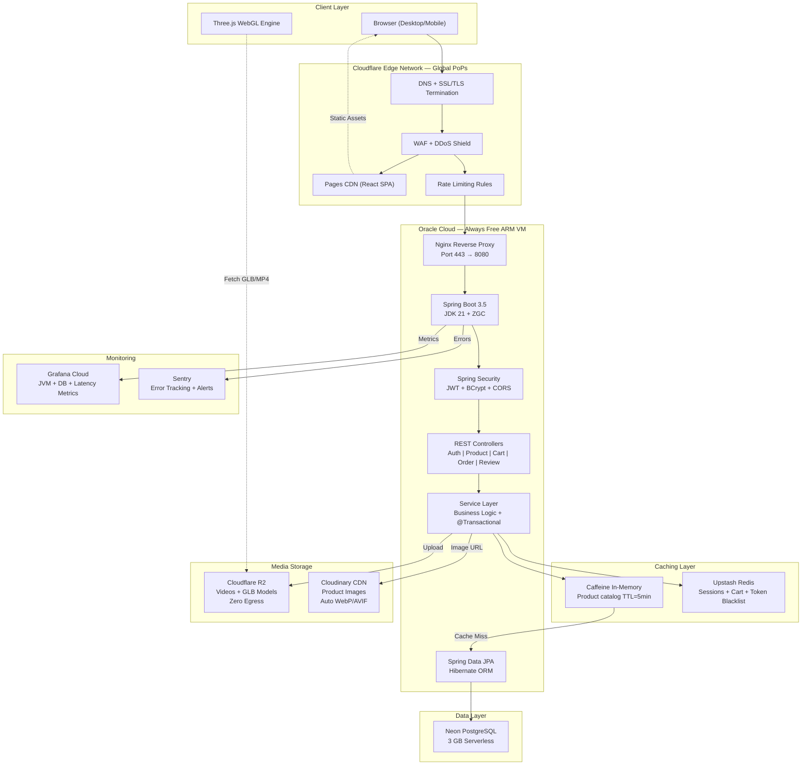

---

## 2. Request Lifecycle (End-to-End Flow)

What happens when a user clicks "Add to Cart" on a product:

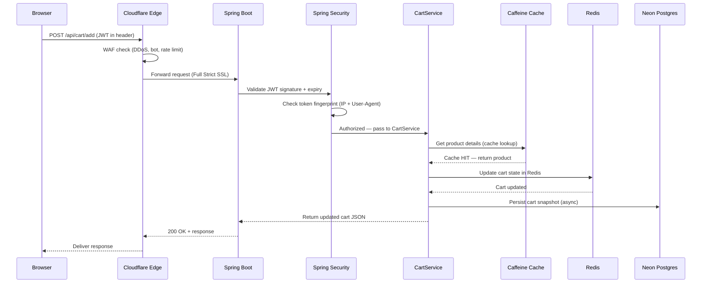

---

## 3. Frontend Architecture

### 3A. Technology Stack & Rationale

| Technology | Purpose | Why This Choice |
|---|---|---|
| **React 18** | UI component library | Virtual DOM for performant re-renders; massive ecosystem |
| **Vite** | Build tool + dev server | 10x faster HMR than Webpack; native ESM support |
| **Three.js + R3F** | 3D WebGL rendering | Industry standard for browser 3D; React bindings via @react-three/fiber |
| **@react-three/drei** | 3D helpers | OrbitControls, Environment maps, GLTF loaders out-of-the-box |
| **GSAP** | Timeline animations | Assembly animation, scroll effects; GPU-accelerated tweens |
| **Framer Motion** | Component transitions | Page entry/exit animations; gesture support |
| **React Router v6** | Client-side routing | SPA navigation without full page reloads |
| **Zustand** | Global state management | Lightweight (1KB); no boilerplate vs Redux; built-in persistence |
| **Vanilla CSS** | Styling | Full control; CSS custom properties for design tokens; no framework lock-in |
| **Lucide React** | Icons | Tree-shakeable; consistent design language |
| **Axios** | HTTP client | Interceptors for JWT injection; request/response transformations |

### 3B. Component Architecture

```
src/
├── main.jsx                    # App entry — mounts React to DOM
├── App.jsx                     # Router + Layout shell
├── index.css                   # Global design tokens + CSS reset
│
├── components/
│   ├── layout/
│   │   ├── Header.jsx          # Glassmorphic navbar (logo, search, auth, cart)
│   │   └── Footer.jsx          # Brand info, links, newsletter, social icons
│   │
│   ├── three/
│   │   ├── Scene.jsx           # Canvas wrapper (WebGLRenderer config, lighting)
│   │   └── Parallettes.jsx     # 3D model (procedural geometry + GSAP assembly)
│   │
│   └── ui/
│       ├── FeatureCards.jsx     # Glassmorphic cards floating around 3D model
│       ├── ProductCard.jsx      # Shop grid card (image, price, variants, cart CTA)
│       ├── ProductCarousel.jsx  # Horizontal scroll carousel
│       └── Loader.jsx           # Brand splash screen animation
│
├── pages/
│   ├── Home.jsx                # Hero + 3D + Welcome + Carousels + Reviews + Discount
│   ├── Shop.jsx                # Product catalog with search/filter
│   ├── ProductDetail.jsx       # Single product + 3D viewer + reviews
│   ├── Cart.jsx                # Cart items + quantity controls + totals
│   ├── Checkout.jsx            # Address + payment + order placement
│   ├── Login.jsx               # Authentication form
│   ├── Register.jsx            # User registration with validation
│   └── OrderHistory.jsx        # Past orders + review submission
│
├── store/
│   ├── authStore.js            # JWT tokens, user profile, login/logout
│   ├── cartStore.js            # Cart items, quantities, totals
│   ├── orderStore.js           # Order history + reviews (with localStorage seed)
│   ├── wishlistStore.js        # Wishlist with localStorage persistence
│   └── sceneStore.js           # 3D scene state (assembly complete flag)
│
├── services/                   # API layer (Axios calls to Spring Boot)
│   └── api.js                  # Base Axios instance + JWT interceptor
│
└── utils/
    └── constants.js            # Product data, helper functions
```

### 3C. State Management Architecture (Zustand)

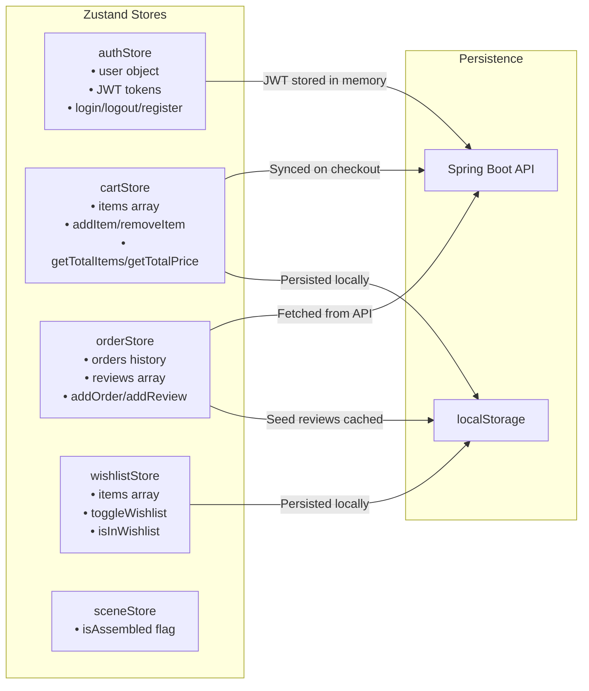

---

## 4. Backend Architecture

### 4A. Technology Stack & Rationale

| Technology | Purpose | Why This Choice |
|---|---|---|
| **Spring Boot 3.5** | Application framework | Auto-configuration, embedded Tomcat, production-ready defaults |
| **JDK 21 (LTS)** | Runtime | Latest LTS; virtual threads, ZGC, pattern matching |
| **Spring Security** | Authentication & authorization | JWT filter chain, BCrypt, method-level `@PreAuthorize` |
| **Spring Data JPA** | Database ORM | Repository pattern; Hibernate under the hood; zero SQL boilerplate |
| **PostgreSQL** (Neon) | Relational database | ACID compliance, JSON support, free serverless hosting |
| **HikariCP** | Connection pool | Fastest Java connection pool; Spring Boot default |
| **Lombok** | Boilerplate reduction | Auto-generates getters/setters/constructors at compile time |
| **Caffeine** | In-memory cache | Zero-dependency; microsecond lookups for hot product data |
| **Spring Data Redis** | Distributed cache | Session tokens, cart state, JWT blacklist via Upstash |
| **Spring Boot Actuator** | Health & metrics | `/actuator/health`, Prometheus endpoint for Grafana |
| **Sentry SDK** | Error tracking | Auto-catches exceptions; sends stack traces to dashboard |

### 4B. Layered Architecture (SOLID Compliant)

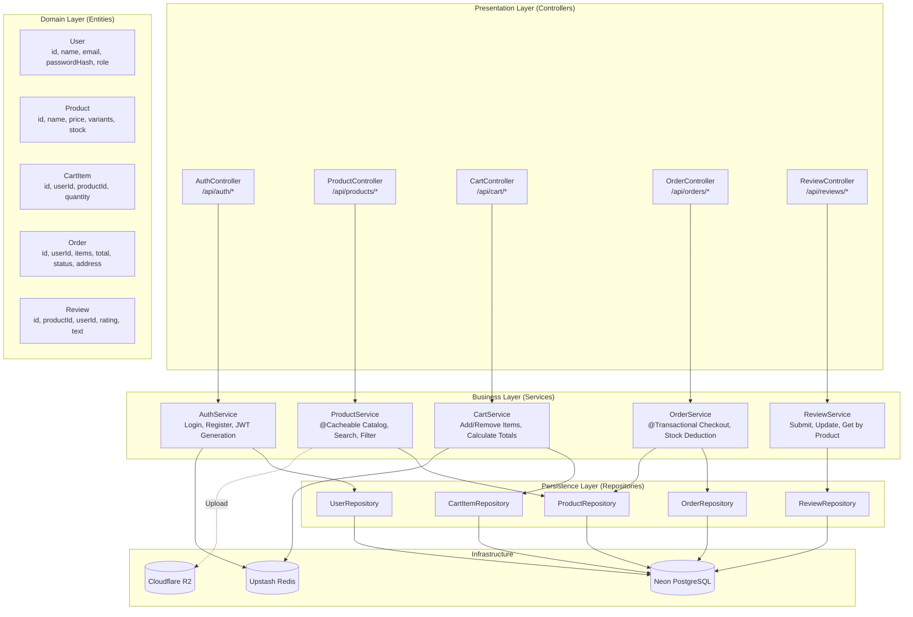

### 4C. Package Structure

```
backend/src/main/java/com/yatrax/
├── YatraXApplication.java              # @SpringBootApplication entry point
│
├── config/
│   ├── SecurityConfig.java             # JWT filter chain, CORS, CSP, security headers
│   ├── CorsConfig.java                 # Allowed origins (Vercel + localhost)
│   ├── CacheConfig.java                # Caffeine cache configuration
│   └── RedisConfig.java                # Upstash Redis connection
│
├── security/
│   ├── JwtTokenProvider.java           # Generate/validate JWT tokens
│   ├── JwtAuthFilter.java              # OncePerRequestFilter — extracts JWT from header
│   └── TokenFingerprint.java           # IP + User-Agent binding for session hijack prevention
│
├── controller/
│   ├── AuthController.java             # POST /api/auth/login, /register, /refresh
│   ├── ProductController.java          # GET /api/products, /api/products/{id}
│   ├── CartController.java             # POST/PUT/DELETE /api/cart
│   ├── OrderController.java            # POST /api/orders, GET /api/orders/history
│   └── ReviewController.java           # POST /api/reviews, GET /api/reviews/product/{id}
│
├── service/
│   ├── AuthService.java                # BCrypt hashing, JWT generation, brute-force lockout
│   ├── ProductService.java             # @Cacheable catalog, search, variant resolution
│   ├── CartService.java                # Redis-backed cart state management
│   ├── OrderService.java               # @Transactional checkout, ACID stock deduction
│   ├── ReviewService.java              # Review CRUD with ownership validation
│   └── StorageService.java             # R2/S3 SDK file upload streaming
│
├── model/
│   ├── User.java                       # @Entity — id, name, email, passwordHash, role, createdAt
│   ├── Product.java                    # @Entity — id, name, description, price, stock, variants
│   ├── CartItem.java                   # @Entity — id, userId, productId, quantity, variant
│   ├── Order.java                      # @Entity — id, userId, items, total, status, address, createdAt
│   └── Review.java                     # @Entity — id, productId, userId, rating, text, createdAt
│
├── repository/
│   ├── UserRepository.java             # findByEmail, existsByEmail
│   ├── ProductRepository.java          # findByNameContaining, findByPriceBetween
│   ├── CartItemRepository.java         # findByUserId, deleteByUserIdAndProductId
│   ├── OrderRepository.java            # findByUserIdOrderByCreatedAtDesc
│   └── ReviewRepository.java           # findByProductId, findByProductIdAndUserId
│
├── dto/
│   ├── LoginRequest.java               # email, password
│   ├── RegisterRequest.java            # name, email, password (with @Valid constraints)
│   ├── CartRequest.java                # productId, quantity, variant
│   ├── OrderRequest.java               # address, paymentMethod, items
│   ├── ReviewRequest.java              # productId, rating, text (with XSS regex validation)
│   └── AuthResponse.java              # accessToken, refreshToken, user profile
│
└── exception/
    ├── GlobalExceptionHandler.java     # @ControllerAdvice — catches all exceptions
    ├── ResourceNotFoundException.java  # 404 responses
    └── AccountLockedException.java     # 429 for brute-force lockout
```

---

## 5. Database Architecture

### 5A. Entity-Relationship Diagram

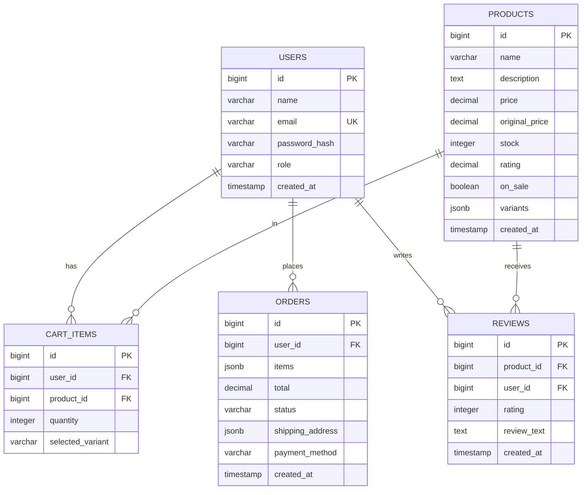

### 5B. Data Storage Strategy

| Data Type | Where It Lives | Why |
|---|---|---|
| User credentials (email, hashed password) | **Neon PostgreSQL** | ACID transactions; relational integrity; encrypted at rest |
| Product catalog (name, price, variants) | **Neon PostgreSQL** + **Caffeine cache** | Source of truth in DB; hot data cached in-memory for 5 min |
| Shopping cart state | **Upstash Redis** + **Neon PostgreSQL** | Redis for real-time speed; DB for persistence across sessions |
| Order records | **Neon PostgreSQL** | Transactional; must survive server restarts; audit trail |
| Product reviews | **Neon PostgreSQL** | Relational (linked to user + product); queryable ratings |
| Product images (JPEG/PNG) | **Cloudinary** | Auto WebP/AVIF conversion; responsive resize on delivery |
| Product videos (MP4 / HLS) | **Cloudflare R2** | Zero egress fees; pre-transcoded to adaptive HLS bitrates |
| 3D models (GLB) | **Cloudflare R2** | Large binary files; immutable cache headers; content-hash filenames |
| JWT blacklist (revoked tokens) | **Upstash Redis** | TTL-based auto-expiry; no DB bloat from expired tokens |
| Session fingerprints | **In JWT claims** | Stateless; validated on every request without DB lookup |

### 5C. Connection Optimization & Pooling (Neon PgBouncer)

To survive with HikariCP `maximum-pool-size=3` and prevent database connection saturation, Yatra X integrates Neon's serverless **PgBouncer** connection pooler in **Transaction Mode**.

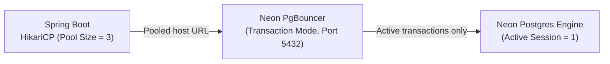

#### PgBouncer Pooler Integration Details:
1. **Pooled Connection URL:** Instead of Neon's direct endpoint, append `-pooler` to the host name.
   - Direct: `ep-cool-morning-123456.ap-southeast-1.aws.neon.tech`
   - Pooled: `ep-cool-morning-123456-pooler.ap-southeast-1.aws.neon.tech`
2. **Prepared Statement Cache Incompatibility:** In Transaction Mode, PgBouncer assigns random backend server connections for every transaction. Standard JDBC prepared statement caching fails because a compiled statement on server A won't exist on server B.
3. **Spring Boot Solution:** Disable server-side statement preparation in `application.properties`:
   ```properties
   # Connect to Neon via PgBouncer Pooler
   spring.datasource.url=jdbc:postgresql://ep-cool-morning-123456-pooler.ap-southeast-1.aws.neon.tech/neondb?sslmode=require&prepareThreshold=0
   
   # Disable Hibernate statement caching to prevent transaction conflicts
   spring.jpa.properties.hibernate.use_sql_comments=false
   spring.jpa.properties.hibernate.format_sql=false
   ```
   Setting `prepareThreshold=0` tells the PostgreSQL JDBC driver to execute statements directly without caching pre-compiled queries on the database server.

---

### 5D. Adaptive HLS Video Streaming Pipeline

Raw MP4 video files stored on Cloudflare R2 will buffer and stall on slow mobile networks (e.g., 4G/3G in India). To prevent this, Yatra X uses **HTTP Live Streaming (HLS)**. Videos are pre-transcoded into 3 quality levels with a master playlist file.

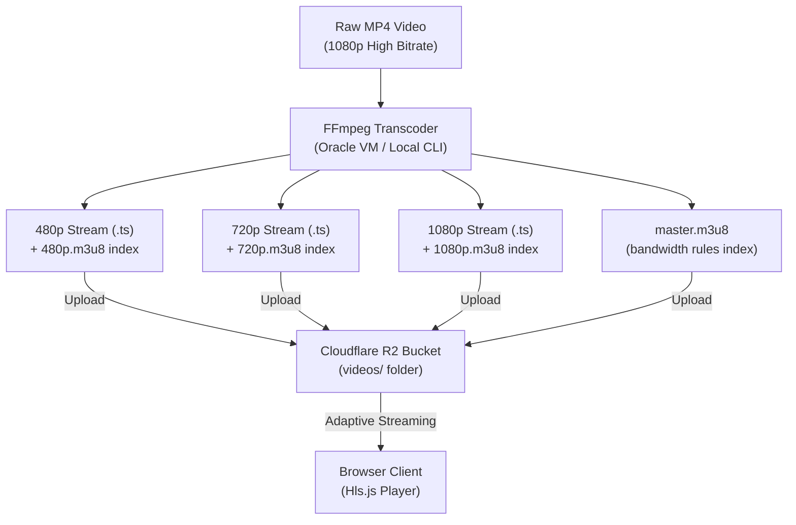

#### Transcoding Script (`transcode-hls.sh`):
Execute this FFmpeg script locally or inside your Oracle VM to prepare video assets before uploading to R2:
```bash
#!/bin/bash
INPUT_VIDEO=$1
OUTPUT_DIR=$2

mkdir -p "$OUTPUT_DIR"

# Transcode into 480p, 720p, and 1080p HLS playlists and segments
ffmpeg -i "$INPUT_VIDEO" \
  -filter_complex "[0:v]split=3[v1][v2][v3]; \
  [v1]scale=w=854:h=480[v1out]; \
  [v2]scale=w=1280:h=720[v2out]; \
  [v3]scale=w=1920:h=1080[v3out]" \
  -map "[v1out]" -c:v:0 libx264 -b:v:0 800k -maxrate:v:0 856k -bufsize:v:0 1200k \
  -map "[v2out]" -c:v:1 libx264 -b:v:1 1400k -maxrate:v:1 1498k -bufsize:v:1 2100k \
  -map "[v3out]" -c:v:2 libx264 -b:v:2 2800k -maxrate:v:2 2996k -bufsize:v:2 4200k \
  -map a:0 -c:a aac -b:a 128k \
  -f hls \
  -hls_time 6 \
  -hls_playlist_type vod \
  -hls_segment_filename "$OUTPUT_DIR/stream_%v_%03d.ts" \
  -master_pl_name master.m3u8 \
  -var_stream_map "v:0,a:0 v:1,a:0 v:2,a:0" "$OUTPUT_DIR/playlist_%v.m3u8"
```

#### React Frontend HLS Player Integration:
Include `hls.js` in your React frontend so that browsers without native HLS support (like Chrome/Firefox on desktop) play adaptive streams smoothly:
```javascript
import React, { useEffect, useRef } from 'react';
import Hls from 'hls.js';

export const AdaptiveVideoPlayer = ({ videoUrl }) => {
  const videoRef = useRef(null);

  useEffect(() => {
    const video = videoRef.current;
    if (!video) return;

    if (Hls.isSupported()) {
      const hls = new Hls();
      hls.loadSource(videoUrl); // e.g., https://pub-xxx.r2.dev/videos/hero/master.m3u8
      hls.attachMedia(video);
    } else if (video.canPlayType('application/vnd.apple.mpegurl')) {
      // Native support in Safari and iOS devices
      video.src = videoUrl;
    }
  }, [videoUrl]);

  return (
    <video 
      ref={videoRef} 
      controls 
      playsInline
      className="video-player"
      style={{ width: '100%', borderRadius: '12px' }}
    />
  );
};
```

---

## 6. Caching Architecture

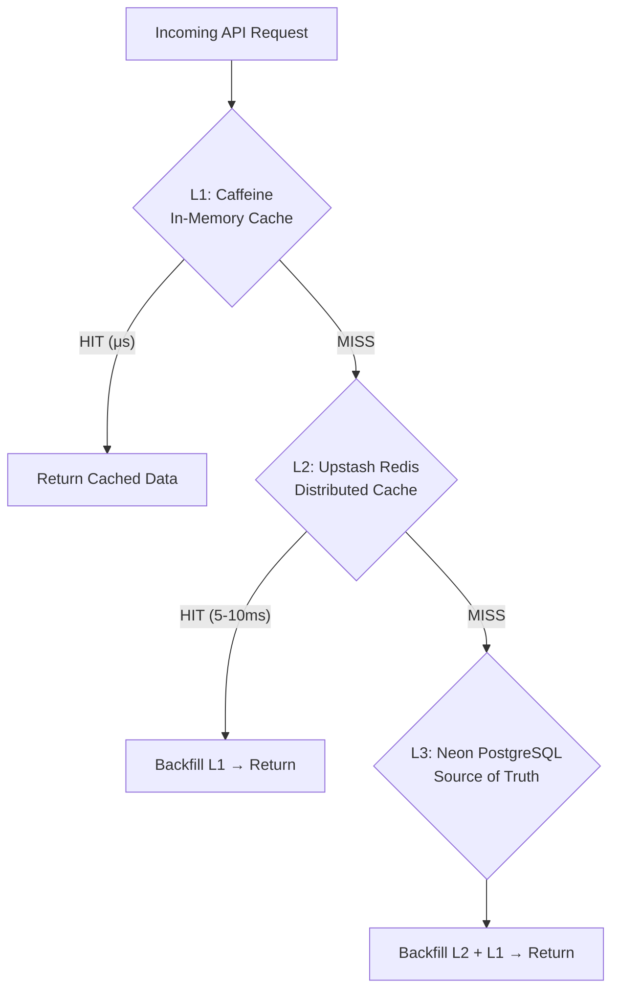

| Cache Layer | Technology | TTL | What's Cached | Avg Latency |
|---|---|---|---|---|
| **L1** (Hot) | Caffeine (JVM heap) | 5 minutes | Product catalog, 3D model metadata | **<1 ms** |
| **L2** (Warm) | Upstash Redis | 30 minutes | Cart state, session tokens, JWT blacklist | **5–10 ms** |
| **L3** (Cold) | Neon PostgreSQL | Permanent | All transactional data (source of truth) | **30–80 ms** |

**Cache Invalidation Strategy:**
- **Write-through:** When a product is updated, `@CacheEvict` clears Caffeine + Redis entries.
- **TTL-based:** Stale data auto-expires; acceptable for catalog (5 min stale is fine).
- **Event-driven:** Order placement evicts cart cache for that user immediately.

---

## 7. Security Architecture

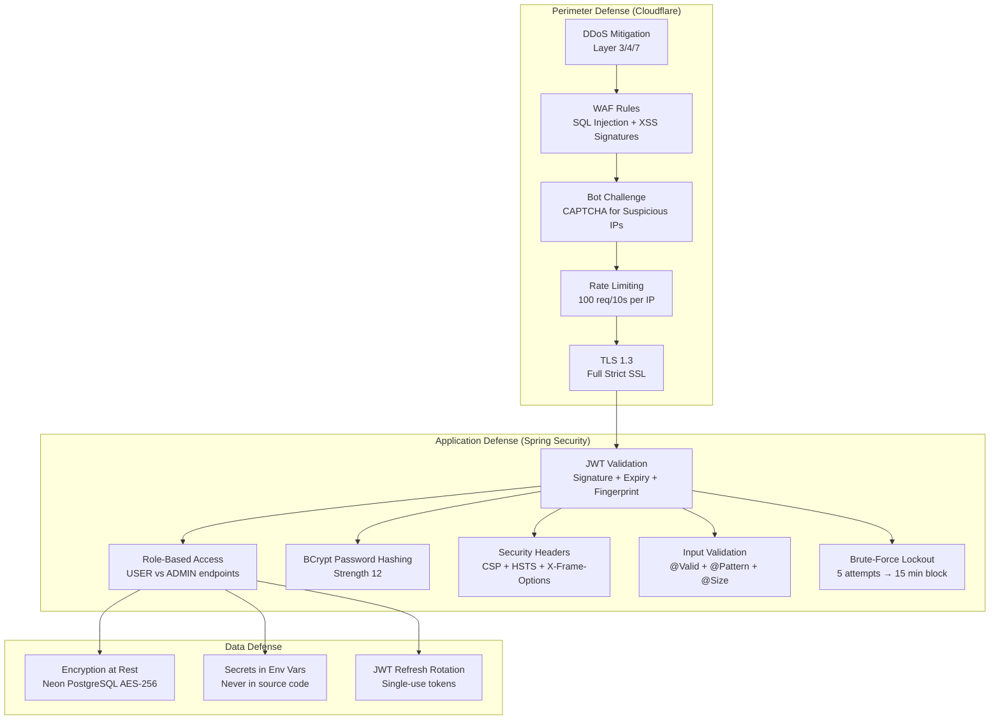

---

## 8. Deployment Architecture (Automated CI/CD with Rollback)

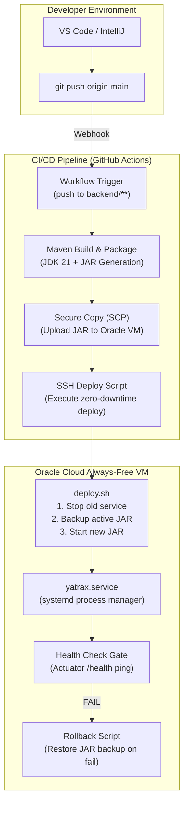

### 8A. Automated GitHub Actions Workflow (`.github/workflows/deploy.yml`)

Create this file in your project repository under `.github/workflows/deploy.yml` to trigger deployments automatically on code updates:

```yaml
name: Yatra X Backend CI/CD

on:
  push:
    branches:
      - main
    paths:
      - 'backend/**'

jobs:
  deploy:
    runs-on: ubuntu-latest

    steps:
      - name: Checkout Code
        uses: actions/checkout@v4

      - name: Set up JDK 21
        uses: actions/setup-java@v4
        with:
          distribution: 'temurin'
          java-version: '21'
          cache: 'maven'

      - name: Build JAR with Maven
        run: |
          cd backend
          chmod +x mvnw
          ./mvnw clean package -DskipTests

      - name: Copy JAR to Oracle VM
        uses: appleboy/scp-action@master
        with:
          host: ${{ secrets.ORACLE_VM_IP }}
          username: ubuntu
          key: ${{ secrets.ORACLE_SSH_KEY }}
          source: "backend/target/backend-0.0.1-SNAPSHOT.jar"
          target: "/opt/yatrax/deploy-temp/"
          strip_components: 2

      - name: Execute Remote SSH Deploy Script
        uses: appleboy/ssh-action@master
        with:
          host: ${{ secrets.ORACLE_VM_IP }}
          username: ubuntu
          key: ${{ secrets.ORACLE_SSH_KEY }}
          script: |
            sudo /opt/yatrax/deploy.sh
```

---

### 8B. VM Environment Setup & Secrets Hardening

To solve **Gap #3 (Plaintext `/etc/environment`)**, secrets are restricted on disk.

1. **Restricted Env File:** Store secrets in a dedicated folder `/etc/yatrax/.env` owned exclusively by the system user running the process, with strictly read-only permissions (`chmod 600`).
2. **Oracle Vault Integration:** For absolute enterprise hardening, secrets can be fetched at VM startup using the **OCI Key Management Service CLI** (which is Always Free for up to 20 secrets) and injected dynamically into systemd environment fields:
   ```bash
   # Oracle Vault secret retrieval command used during startup:
   oci secrets secret-bundle get --secret-id <ocid-secret-id> --query "data.\"secret-bundle-content\".content" --raw-output | base64 --decode
   ```

3. **Systemd Service Manager Configuration (`/etc/systemd/system/yatrax.service`):**
```ini
[Unit]
Description=Yatra X Spring Boot Application
After=network.target

[Service]
User=ubuntu
WorkingDirectory=/opt/yatrax
# Read variables from the restricted 600-permission file
EnvironmentFile=/etc/yatrax/.env
# High performance ZGC VM tuning parameters
ExecStart=/usr/bin/java $JAVA_OPTS -jar /opt/yatrax/backend.jar --spring.profiles.active=production
SuccessExitStatus=143
Restart=on-failure
RestartSec=10

[Install]
WantedBy=multi-user.target
```

---

### 8C. Self-Healing Zero-Downtime Rollback Script (`/opt/yatrax/deploy.sh`)

This script runs on the VM during deployment. If the new backend version fails to start (e.g. database timeout, configuration typo, or boot failure), it immediately rolls back to the working version:

```bash
#!/bin/bash
set -e

APP_DIR="/opt/yatrax"
TEMP_DIR="/opt/yatrax/deploy-temp"
SERVICE_NAME="yatrax.service"

echo "=== Starting Yatra X Backend Deployment ==="

# Step 1: Backup current working version
if [ -f "$APP_DIR/backend.jar" ]; then
    echo "Creating backup of current active backend..."
    cp "$APP_DIR/backend.jar" "$APP_DIR/backend.jar.bak"
fi

# Step 2: Swap the JAR file
echo "Installing new JAR version..."
mv "$TEMP_DIR/backend-0.0.1-SNAPSHOT.jar" "$APP_DIR/backend.jar"

# Step 3: Restart systemd service
echo "Restarting service..."
systemctl daemon-reload
systemctl restart $SERVICE_NAME

# Step 4: Health Check Gate
echo "Checking service health (Actuator validation)..."
HEALTH_URL="http://localhost:8080/actuator/health"
MAX_ATTEMPTS=24 # 24 attempts * 5 seconds = 120 seconds max timeout
ATTEMPT=1
IS_UP=0

while [ $ATTEMPT -le $MAX_ATTEMPTS ]; do
    echo "Ping health endpoint (Attempt $ATTEMPT/$MAX_ATTEMPTS)..."
    RESPONSE=$(curl -s -o /dev/null -w "%{http_code}" $HEALTH_URL || true)
    
    if [ "$RESPONSE" -eq 200 ]; then
        HEALTH_STATUS=$(curl -s $HEALTH_URL | grep -o '"status":"UP"' || true)
        if [ ! -z "$HEALTH_STATUS" ]; then
            echo "Success! Health check passed."
            IS_UP=1
            break
        fi
    fi
    
    sleep 5
    ATTEMPT=$((ATTEMPT+1))
done

# Step 5: Rollback if health check failed
if [ $IS_UP -eq 0 ]; then
    echo "WARNING: Health check failed! Initiating self-healing rollback..."
    
    if [ -f "$APP_DIR/backend.jar.bak" ]; then
        mv "$APP_DIR/backend.jar.bak" "$APP_DIR/backend.jar"
        systemctl restart $SERVICE_NAME
        echo "Rollback successful. Restored previous stable version."
    else
        echo "ERROR: Critical error. No stable backup version available!"
    fi
    exit 1
else
    # Success, clean backup
    echo "Deployment successful. Cleaning old backups."
    rm -f "$APP_DIR/backend.jar.bak"
fi
```

---

## 9. Observability Architecture

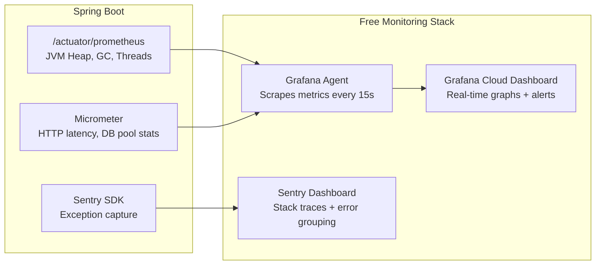

### Alert Rules

| Metric | Threshold | Action |
|---|---|---|
| JVM Heap Usage | > 80% for 5 min | Email alert — possible memory leak |
| HikariCP Active Connections | = 3 (pool maxed) for 2 min | Email alert — DB bottleneck |
| HTTP 5xx Error Rate | > 5% of requests | Sentry email with stack trace |
| GC Pause Duration | > 50ms | Email alert — ZGC misconfiguration |
| Response Latency P95 | > 2 seconds | Email alert — slow queries or cache miss storm |

---

## 10. Design Principles Applied

| Principle | How It's Applied |
|---|---|
| **Single Responsibility (S)** | Each class has one job: Controller parses HTTP, Service holds logic, Repository talks to DB |
| **Open/Closed (O)** | `PaymentGateway` interface — add Razorpay without modifying checkout code |
| **Liskov Substitution (L)** | All repositories extend `JpaRepository<T, ID>` — swappable implementations |
| **Interface Segregation (I)** | Thin DTOs per endpoint — `LoginRequest` vs `RegisterRequest` vs `CartRequest` |
| **Dependency Inversion (D)** | Services depend on repository interfaces, not concrete classes; Spring DI injects |
| **ACID Transactions** | `@Transactional` on checkout — stock + payment + order = atomic rollback on failure |
| **Stateless Architecture** | No server-side sessions; JWT in header; horizontal scaling ready |
| **Defense in Depth** | 3 security layers: Cloudflare edge → Spring Security → data encryption |
| **Cache-Aside Pattern** | L1 Caffeine → L2 Redis → L3 PostgreSQL with TTL-based invalidation |
| **12-Factor App** | Config in env vars; stateless processes; logs to stdout; disposable containers |
